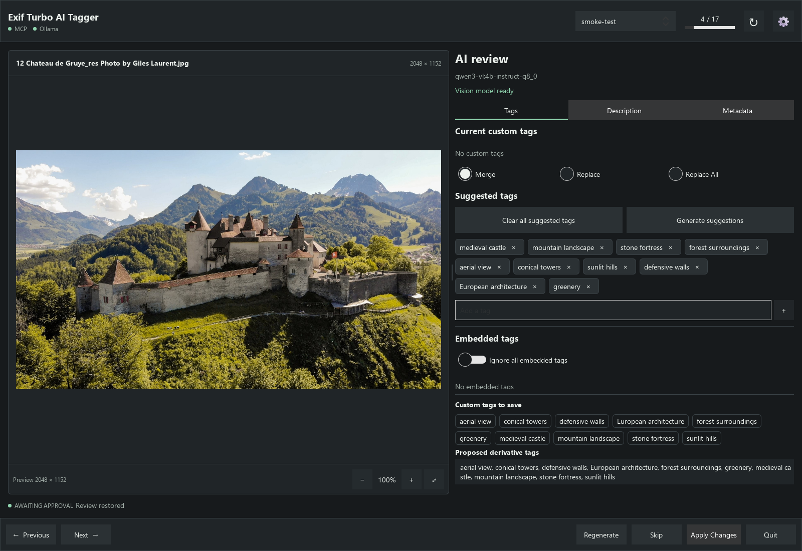

# Exif Turbo AI Tagger

A desktop companion to [Exif Turbo](https://github.com/baddonkey/exif-turbo) and
[Ollama](https://ollama.com/). Review AI-generated tags and descriptions, choose
which embedded metadata to include, and save only the changes you approve.



Photo: &copy; Giles Laurent, [gileslaurent.com](https://gileslaurent.com/),
License [CC BY-SA 4.0](https://creativecommons.org/licenses/by-sa/4.0/).
[Image sources and screenshot licensing](docs/screenshots/README.md).

## Get Started

Requires Python 3.11+, Exif Turbo with an unlocked database and MCP enabled, and
Ollama with a vision model. Enable custom tagging in Exif Turbo to save changes.

```sh
python -m venv .venv
```

Use `python3` if your system does not provide a `python` command.

Activate with `.venv\Scripts\Activate.ps1` in PowerShell or
`source .venv/bin/activate` on macOS/Linux, then run:

```sh
python -m pip install -e .
tag-exif-turbo
```

Set the service URLs and model in **Settings** or [.env.example](.env.example).
Defaults are MCP at `http://127.0.0.1:8765/mcp`, Ollama at
`http://127.0.0.1:11434`, and model `qwen3-vl:4b-instruct-q8_0`.
Models are not downloaded automatically.

Choose an image source, review the suggestions, then **Apply Changes** or **Skip**.
Applying updates Exif Turbo's sidecar and index, not the original image file.

## Learn More

- [User guide](docs/user-guide.md): illustrated workflows, settings and troubleshooting.
- [Project specification](docs/project-spec.md): architecture, configuration and verification.
- [Image credits](docs/screenshots/README.md): original sources, authors and licences.

## Develop

```sh
python -m pip install -e ".[dev]"
python -m pytest -q
```
