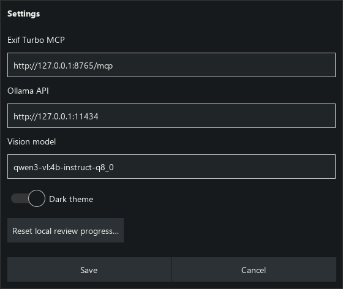
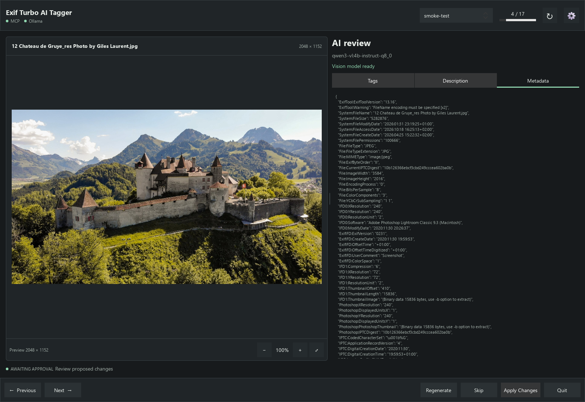
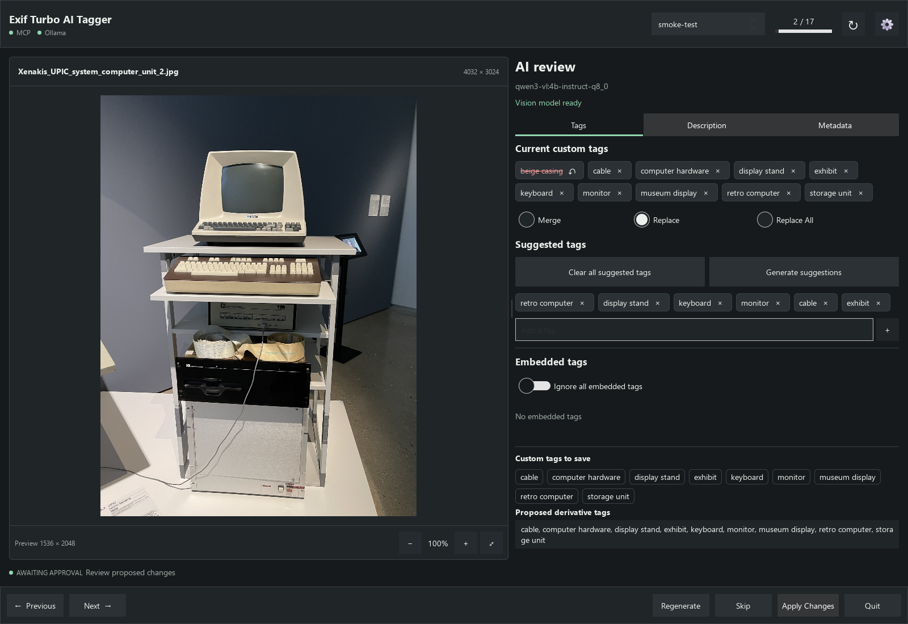
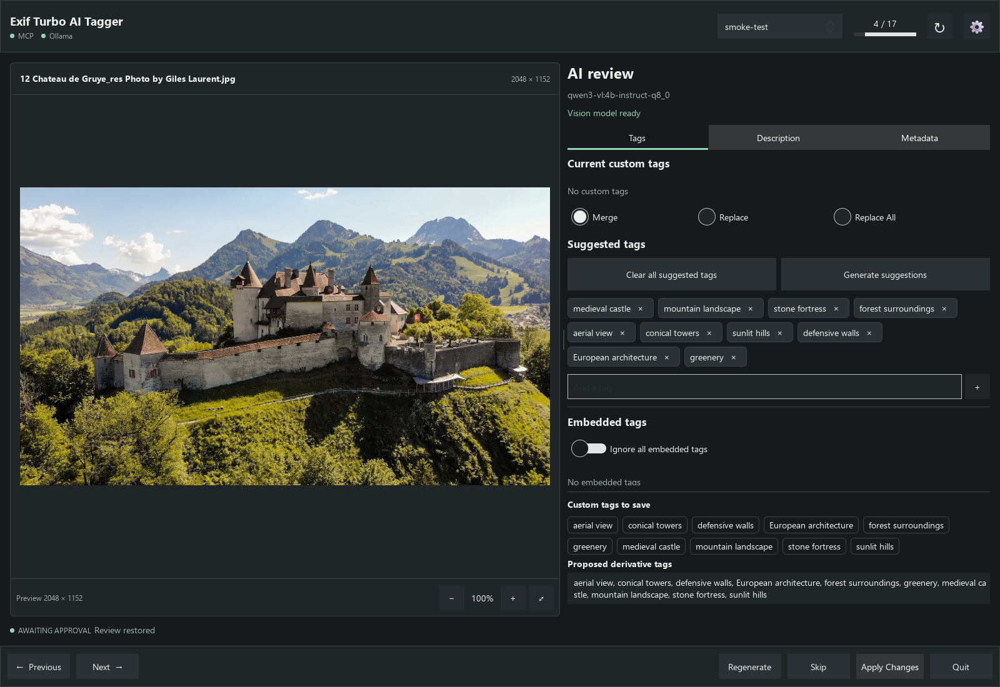
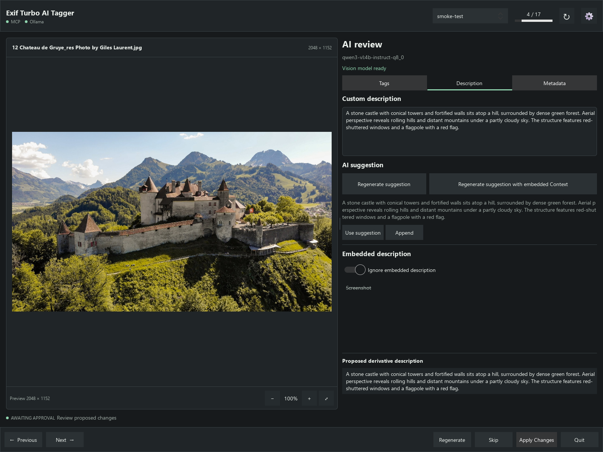
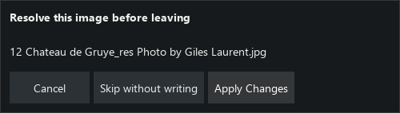
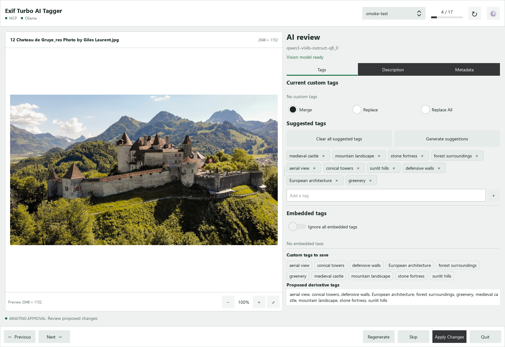

# User Guide

Exif Turbo AI Tagger helps you review image tags and descriptions suggested by
Ollama, then save only the changes you approve through Exif Turbo.

## Contents

1. [Before you start](#1-before-you-start)
2. [Choose images](#2-choose-images)
3. [Inspect images and metadata](#3-inspect-images-and-metadata)
4. [Review custom tags](#4-review-custom-tags)
5. [Include or ignore embedded tags](#5-include-or-ignore-embedded-tags)
6. [Write and refine descriptions](#6-write-and-refine-descriptions)
7. [Apply, skip and navigate](#7-apply-skip-and-navigate)
8. [Resume reviews and change settings](#8-resume-reviews-and-change-settings)
9. [Recover from errors](#9-recover-from-errors)
10. [Keyboard shortcuts](#10-keyboard-shortcuts)
11. [Privacy and image credits](#11-privacy-and-image-credits)

Screenshots use the real `smoke-test` set and live model suggestions. They show
local review drafts; no Apply or reset operation was performed to create them.
Connection URLs in the Settings capture are standard examples, not saved private
service addresses. Photo sources and licences are listed in
[the image credits](screenshots/README.md).

## 1. Before You Start

You need Exif Turbo running with its database unlocked and MCP enabled, plus
Ollama with the configured vision model installed. Enable custom tagging in
Exif Turbo if you want to save changes. Models are not downloaded automatically.

Open **Settings** with the gear button or `Ctrl+,` to check the Exif Turbo MCP URL,
Ollama API URL and vision-model name. Environment variables take precedence over
saved service settings; see [the configuration example](../.env.example).

*Settings: enter the addresses of your own running services. This cropped dialog
contains no third-party photograph.*

The MCP and Ollama indicators show connectivity. The review panel also shows
whether the vision model is ready. If it is missing, the app shows the command
to install that exact model yourself.

The window starts maximized. Restore it if you prefer a smaller window, and drag
the divider between the image and review panel to change their widths. Settings
includes a **Dark theme** switch.

Only one instance runs per signed-in user. Launching again brings the existing
window forward; a minimized window is restored. On Windows the app has its own
taskbar icon rather than Python's icon.

## 2. Choose Images

Use the image-source dropdown to select an image set from the active Exif Turbo
database. The counter shows your position. The progress bar is animated while
work is in progress.

Choose **Current selected image** to review only the image selected in Exif Turbo.
After changing the selection there, click **Reload image** in the tagger. A pending
review must be resolved before reloading, so a different image cannot silently
replace your draft.

Startup restores the last review when possible. Without saved progress, it opens
the preferred set or the first available set. Set `DEFAULT_IMAGE_SET` before
starting to choose a preferred set for new reviews. This guide uses `smoke-test`;
your sets can have any names.

*The image-source selector is at the upper right. Photograph: &copy; Giles Laurent,
gileslaurent.com, License CC BY-SA; [source and CC BY-SA 4.0 terms](screenshots/README.md#gruyeres-castle).*

## 3. Inspect Images and Metadata

The image is fitted without changing its aspect ratio. Use the mouse wheel,
pinch gesture or plus/minus controls to zoom, then drag an enlarged image to
pan. The fit control returns to the fitted view. Zoom is limited to 12x.

The header shows original image dimensions when available. The footer labels
preview dimensions separately. Analysis uses the preview supplied by Exif Turbo,
which may be smaller than the original. Original RAW files are not decoded
directly by the tagger.

The review panel has **Tags**, **Description** and **Metadata** tabs. A coloured
underline marks the active tab. Metadata shows selectable, read-only image
metadata; editing happens in Tags and Description, not in that view.

*Metadata is inspectable, not editable here. Private directory/source-file fields
are omitted from this documentation capture. Photograph: &copy; Giles Laurent,
gileslaurent.com, License CC BY-SA; [source and licence](screenshots/README.md#gruyeres-castle).*

## 4. Review Custom Tags

**Current custom tags** appear first. Suggested tags are separate and can be
changed before anything is saved.

Click a suggested tag's x to remove it. Type in **Add a tag** and press Enter or
click plus to add your own. **Clear all suggested tags** empties only the suggestion
list, not saved tags. **Generate suggestions** requests fresh analysis. The footer
**Regenerate** action also requests image analysis; neither action saves changes.

Choose a tag mode:

| Mode | Result when you apply |
| --- | --- |
| Merge | Keep saved custom tags and add reviewed suggestions. This is the default. |
| Replace | Save the reviewed custom-tag list. Restore saved tag pills you want to retain. |
| Replace All | Same custom-tag replacement behavior as Replace, on this image only. |

Removing a current custom tag switches to Replace while keeping the other saved
tags. A struck-through saved pill is staged for removal; its restore control
puts it back. Selecting Replace explicitly starts with the suggestions, so
restore saved tags you want to keep.

Removals require confirmation when applying. An empty replacement list clears
custom tags, but not embedded image metadata. Replace and Replace All never
change embedded exclusions automatically and are not bulk operations.

**Custom tags to save** previews the exact pending custom list as pills.
**Proposed derivative tags**, at the bottom, also includes embedded keywords
that have not been ignored. These are previews, not confirmation of a save.

*A saved tag is struck through for removal; the save preview shows the remaining
list. Photograph: 1904.CC (Manuel Schmalstieg), CC0, via Wikimedia Commons;
[original source](screenshots/README.md#xenakis-upic-computer).*

## 5. Include or Ignore Embedded Tags

Embedded tags come from original image metadata and are separate from custom
tags. Click anywhere on an embedded pill, including its x, to toggle its ignored
state. Ignored pills remain visible with strike-through. Click again to restore
inclusion.

**Ignore all embedded tags** excludes the embedded list and disables individual
toggles. Turning it off restores your individual choices. Excluding an embedded
tag does not remove a custom tag with the same wording.

These choices affect derivative copies produced by Exif Turbo. They do not change
the original image, erase its metadata or remove it from source metadata search.
They remain local until Apply Changes. Derivative export itself is done in Exif
Turbo, not in this app.

*This sample has no embedded keywords, so the app shows its real empty state.
Images with keywords show clickable pills in this section. Photograph: &copy;
Giles Laurent, gileslaurent.com, License CC BY-SA;
[source and licence](screenshots/README.md#gruyeres-castle).*

## 6. Write and Refine Descriptions

Description separates your editable **Custom description**, the **AI suggestion**
and the read-only **Embedded description**. Enter inserts a newline in editors.

**Generate suggestion** creates an image-only proposal; after one exists the
button reads **Regenerate suggestion**. It does not replace edited tags or
overwrite manual description text. Initial analysis may fill an empty, untouched
custom draft.

The adjacent button uses the same wording followed by **with embedded Context**.
It rewrites the embedded caption using visual details from the image. Use it
when that caption contains useful information you want retained in a better
description. It is disabled without an embedded caption or a ready model.
Captions longer than 2,000 characters are rejected, not silently cut.

The context action works even when **Ignore embedded description** is on. That
switch controls whether original embedded text appears in derivatives, not
whether the model can use it as context. The button sends the embedded caption,
not the editable custom draft, to the configured Ollama endpoint.

The result stays in the suggestion area. **Source context used** identifies a
context-based proposal. **Review notes** may flag uncertainty or contradictions.
Names, dates, places and events supplied by a caption may be retained, but are
not independently verified. Read the result yourself; the model can still omit
details or make mistakes.

**Use suggestion** replaces the custom draft, with confirmation before replacing
existing text. **Append** adds the proposal as another paragraph. Neither saves
immediately. To remove a saved custom description, empty the editor and Apply;
clearing saved text requires confirmation.

**Ignore embedded description** leaves the source text readable with strike-through
and excludes it from derivatives. It does not clear your custom description.
The proposed derivative description below the editor combines included embedded
text and the custom draft, separated by a blank line. With embedded text ignored,
only your custom description remains in that preview.

*The two generation buttons create proposals. Ignore embedded description is on
in this draft, so the derivative preview contains only the custom text. No change
has been applied. Photograph: &copy; Giles Laurent, gileslaurent.com, License CC BY-SA;
[source and licence](screenshots/README.md#gruyeres-castle).*

## 7. Apply, Skip and Navigate

**Apply Changes** saves approved custom tags, description edits and embedded
exclusion choices for the current image. You can apply only description changes
or only exclusion changes; tag suggestions are not required. Custom tagging and
the corresponding MCP capabilities must be enabled. Unavailable controls are
disabled.

Exif Turbo saves to its sidecar and index, not the original image bytes. There
is no automatic approval. A successful Apply advances to the next image or
completes the review when there are no more images.

**Skip** writes nothing and moves on. Proposed saved-tag removals, description
edits and exclusion changes are discarded. Regenerate creates proposals without
saving or advancing.

**Previous** and **Next** navigate through a set. If a review is pending, leaving
it, changing source, reloading the current selection, changing service settings
or quitting may show **Apply Changes**, **Skip without writing** and **Cancel**.
Cancel keeps the current review. Quit does not ask for a write decision when
metadata is unchanged, including reverted edits and unused description proposals.

*Choose whether to save or discard a pending review before leaving. This cropped
dialog contains no third-party photograph.*

During analysis you can use Previous or Next without waiting for Ollama. The
old request cannot replace the new image's draft. Returning to deferred analysis
restarts it. Navigation is disabled during preview loads, writes and unresolved
write recovery.

## 8. Resume Reviews and Change Settings

Local progress remembers the source, position, draft edits and proposals.
Reopening normally resumes that review. Revisiting an applied or skipped image
does not automatically analyze or write it again.

Settings saves endpoints, model choice and theme. It does not download models,
substitute another model or unload a model for you. Use the toolbar reconnect
button after making external service changes.

**Reset local review progress** discards local drafts and starts from the first
image. A confirmation protects against accidental resets. It does not undo tags,
descriptions or exclusions already saved by Exif Turbo.

*Theme changes do not apply metadata changes. Photograph: &copy; Giles Laurent,
gileslaurent.com, License CC BY-SA;
[source and licence](screenshots/README.md#gruyeres-castle).*

## 9. Recover From Errors

The error banner explains a failed operation. **Retry** reconnects unavailable
services or retries analysis as appropriate. The question-mark button opens
connection details, including discovered MCP capabilities.

For unavailable MCP, unlock the Exif Turbo database, enable MCP and check the
URL. For Ollama, check the endpoint, exact model name and vision support. After
an inference timeout, inspect model load and available memory in Ollama; the app
preserves your review.

An interrupted Apply differs from failed analysis: some changes may already be
saved because Apply uses multiple operations. Retry first rereads the image
without repeating writes. Review the saved state and explicitly Apply again to
finish remaining changes. Do not assume failure means nothing was saved.
Navigation and Skip stay blocked until reconciliation.

If the selected image or database identity changes, the app refuses an unverified
write. Confirm the intended database and image in Exif Turbo. A saved-review
identity mismatch may require resetting local progress after checking the target.

## 10. Keyboard Shortcuts

| Action | Shortcut |
| --- | --- |
| Previous image | Alt+Left |
| Next image | Alt+Right |
| Apply Changes | Ctrl+Enter |
| Regenerate image analysis | Ctrl+R |
| Settings | Ctrl+, |
| Quit | Platform-standard Quit shortcut |

Image-navigation shortcuts are suppressed while editing text. Ctrl+Enter applies
the whole review; it is not a separate description-save shortcut.

## 11. Privacy and Image Credits

Image previews go to the configured Ollama service for analysis. The context
button also sends the embedded caption. That service may be remote if you
configured a remote endpoint.

Local history contains image paths, draft metadata and request snapshots, but
not preview image bytes. Exif Turbo sidecars remain subject to the permissions
and backup policy of their image folders. Review screenshots before sharing:
they can reveal image content, filenames, captions and service addresses.

The AI never receives MCP write tools. Human approval remains the boundary for
metadata changes. Keep backups and inspect proposed changes, especially tag
replacement, description clearing and context-based factual claims.

Photographs in this guide are credited separately from the application:
see [image sources and screenshot licensing](screenshots/README.md).
For technical configuration and architecture, see the
[project specification](project-spec.md).